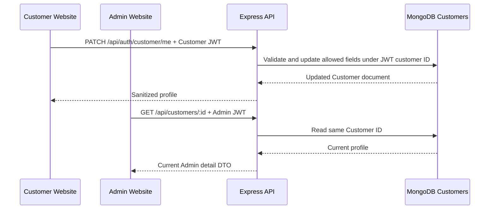

# Customer Management Integration Design

**Sprint 2 baseline:** `origin/main` at `8ae55fd`; branch `feature/customer-settings-integration`.

## Ownership and data flow

The MongoDB `Customers` collection is the canonical profile store. The Customer Website authenticates through `POST /api/auth/customer/login` or registration, then reads and updates its own record through `/api/auth/customer/me`. The backend resolves the customer ID from a signed JWT and reloads the active customer from MongoDB. The Admin Customer page reads the same collection through authenticated `/api/customers` endpoints; opening the detail modal revalidates the selected record. No duplicate Admin profile table or synchronization queue is introduced.

## Profile contract

| Endpoint | Authentication | Input/output | Rule |
|---|---|---|---|
| `POST /api/auth/customer/register` | Public | `fullName`, `email`, `phone`, `password`; token and sanitized profile | Validates name, email, phone and 8–128 character password; rejects duplicate email/phone. |
| `POST /api/auth/customer/login` | Public | Email/phone and password; token and sanitized profile | Bcrypt verification against a persisted active Customer only. |
| `GET /api/auth/customer/me` | Customer JWT | Sanitized current profile | Reloads the record on each request. |
| `PATCH /api/auth/customer/me` | Customer JWT | Allowlist: `fullName`, `phone`, `birthDate`, `gender` | Rejects arbitrary IDs, admin fields, invalid formats and duplicate phone. Email is read-only because no verified change-of-email flow exists. |
| `GET /api/auth/customer/orders` | Customer JWT | Own order snapshots | Filters by JWT customer ID and excludes internal fields. |
| `GET /api/customers/:id` | Admin JWT and persisted Employee | Existing Admin detail DTO | Reads the same Customer collection; modal refreshes on open. |

Existing customer IDs are stable. Order references continue to use `Order.customerId`. The profile response excludes `passwordHash`, internal counters and arbitrary document fields. The Customer Website displays loading, error and success states for profile save. Admin list search, status filter, pagination and detail remain in their existing module.

## Security decisions and limits

The previously simulated customer login and demo/master Admin credentials were removed with user approval. Admin Customer, Voucher, Shipping and Order routes require a valid JWT and a persisted Employee. Fine-grained employee roles need a team role matrix before implementation. Password recovery returns a non-successful response until a verified delivery channel exists; the UI does not claim a reset message was sent. Existing accounts whose password hashes were never set cannot log in until the team provisions a secure password reset path.

## Verification

The isolated local E2E run logged in with a persisted customer, changed the name, reloaded the page, and then opened the same customer in Admin. The subsequent Admin API read returned that updated name under the same ID. Five focused profile controller tests and the separate database/security checks cover allowlisting, invalid phone, duplicate phone, unauthorized update and sanitized output. These results do not assert writes to the team's Atlas database.
