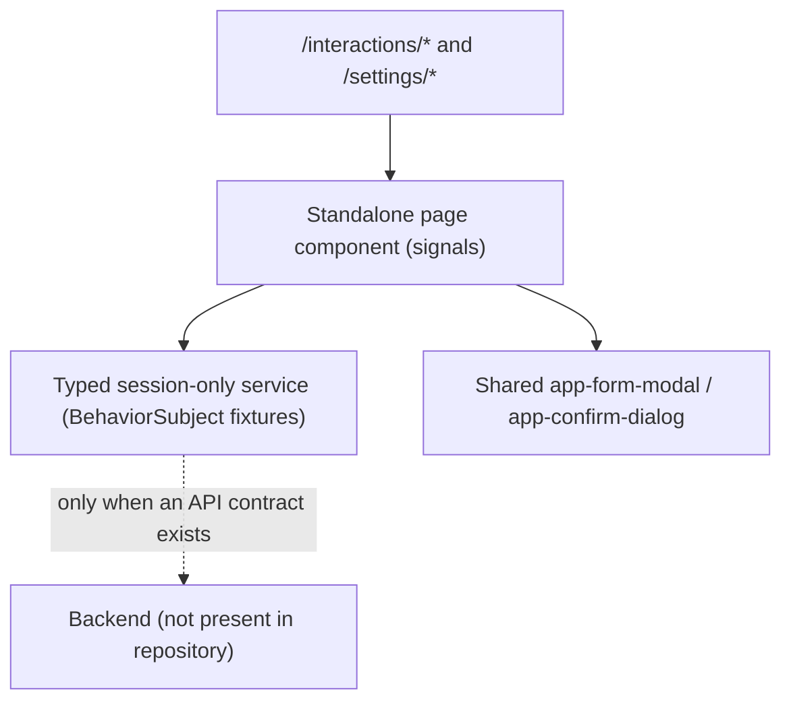

# LIVORA — Interaction Management Module Design

> **Module:** Quản lý tương tác (Interaction Management) — Admin
> **Screens:** Contact list `/interactions/contact`, Review list `/interactions/reviews`, Voucher setup `/settings/vouchers`, Shipping setup `/settings/shipping`
> **Status:** Architecture aligned with `artifact/SYSTEM_DESIGN.md` and `artifact/REPORT.docx`; implemented with session-only typed mock services (no backend contract exists).
> **Documentation language:** Technical English.

---

## 1. Executive Summary & Assigned Scope

The assignment covers the six exported design references in `artifact/design-reference/Quản lý tương tác/`, which map to four Admin screens:

1. **Contact Management (`/interactions/contact`)** — service-request list with keyword/status/time filtering, pagination, read-only detail dialog, and the BPMN "Duyệt xử lý" status transition.
2. **Review Management (`/interactions/reviews`)** — customer-review list with keyword/star/status filtering, pagination, review detail dialog, and the moderation "Ẩn đánh giá" action with reason capture.
3. **Voucher Setup (`/settings/vouchers`)** — voucher registry with search/type/status/time filters, usage progress, on/off switch, detail dialog, and the "Thêm mới Voucher khuyến mãi" create/edit dialog.
4. **Shipping Setup (`/settings/shipping`)** — province/method shipping-fee registry with search/method/status filters, apply/pause switch, and the "Thêm mới Cấu hình vận chuyển" create/edit dialog.

Voucher and Shipping live under the settings menu in routing/sidebar (`/settings/*`), not under `/interactions/*`; they are included because the module's design-reference folder contains their exported screens. No separate interaction-management design document existed in `artifact/` before this one; requirements were derived from `REPORT.docx` and `SYSTEM_DESIGN.md`. Proposals recorded in `SYSTEM_DESIGN.md` (for example the Room-specific deactivation rules) are **not** treated as approved function for this module.

## 2. Requirement Sources & Traceability Matrix

| Requirement | Source | Design reference | Approved scope / status | Provisional or pending |
|---|---|---|---|---|
| Contact registry & detail | `REPORT.docx` 3.2.2.8 (Table 14 "Xử lý liên hệ"), 3.3.2.9 (BPMN Fig. 32), Table 28 (Contacts) | `Quản lý liên hệ - Danh sách liên hệ` | List with contact code, customer, phone, email, request content, sent time, status; detail content view; only "Duyệt xử lý" moves a request from "Chưa xử lý" to "Đã xử lý"; support happens outside the system (no chat feature) | Contact code `LH-YYMM-XXX` is a provisional UI identifier (Table 28 defines only `_id`). Table 28 also declares a `processing` status that the approved BPMN/UI do not use — see §8 |
| Review moderation | `REPORT.docx` 3.2.2.8, 3.3.2.10 (BPMN Fig. 33), Table 26 (Reviews) | `Quản lý đánh giá - Danh sách đánh giá` | Reviews are auto-visible after submission (no pre-approval); Admin can only hide an inappropriate review, records hidden reason/actor/time; hidden reviews are retained and not counted as visible | Review code `DG-XXXX` and the "Tài khoản nghi vấn / spam" row flag are provisional UI fields. No un-hide exists in the workflow |
| Voucher management | `REPORT.docx` 3.2.2.2 (Table 8 "Quản lý voucher"), 3.3.2.11 (BPMN Fig. 34), Table 27 (Vouchers) | `Thiết lập Voucher - Danh sách voucher`, `- Popup thêm mới voucher` | List with code, program title, discount type, discount value, minimum order, max discount, usage, applicability window, status; create/update/toggle; percentage vs fixed amount; actual discount never exceeds the configured cap; order must reach the minimum | "Giới hạn lượt dùng / Mỗi khách hàng" (`perCustomerLimit`) is a provisional UI-only field (no Table 27 column) — see §8 |
| Shipping setup | `REPORT.docx` 3.2.2.2 (Table 8 "Thiết lập vận chuyển"), Table 29 (Shipping) | `Thiết lập Vận chuyển - Danh sách cấu hình vận chuyển`, `- Popup thêm mới cấu hình vận chuyển` | List with method (`standard`/`express`), province, fee, estimated delivery time, active flag, updated date; create/update; apply/pause | Table 29 defines no BPMN; the list/dialog also show hub name, fee note, free-shipping threshold, committed time slot and White-Glove standard — all marked provisional (`hub`, `feeNote`, `freeShipEnabled/Threshold`, `timeSlot`, `whiteGloveIncluded`) — see §8 |

## 3. Architecture & Design Patterns

Following the approved conventions of the implemented Admin modules (SYSTEM_DESIGN.md §3, §4, §10):

- **Standalone components** with direct route loading; the existing route definitions, sidebar and app shell are unchanged.
- **Typed models per feature** (`contact.model.ts`, `review.model.ts`, `voucher.model.ts`, `shipping.model.ts`) with domain types such as `ContactStatus`, `ReviewStatus`, `VoucherDiscountType`, `ShippingMethod`.
- **Typed service boundary with session-only fixtures.** No backend or API contract exists in the repository, so each service exposes RxJS `Observable` methods over an in-memory `BehaviorSubject` seeded with demo fixtures (48 contacts, 342 reviews, 36 vouchers, 54 shipping configurations). All mutations stay in the browser session, reset on reload, and can be replaced by an approved API implementation without changing the components. Mutations follow the established `of(null).pipe(map(...))` pattern (value read via `getValue()`, validation errors thrown into the Observable error channel).
- **Component state with Angular Signals** (`contacts()`, `reviews()`, `vouchers()`, `configs()`, loading/error/pagination/modal/toast signals) and a `ChangeDetectorRef.markForCheck()` call in async handlers, matching sibling modules.
- **Shared UI reuse:** `app-form-modal` (detail and create/edit dialogs) and `app-confirm-dialog` (contact resolve confirmation). Table/pagination markup is feature-local because the reference layouts need rich cells (two-line codes, usage bars, star ratings, method pills, switches) that the generic `DataTable` does not express without heavy cell templates; this mirrors the Customer/Product/Room modules.
- **Styling:** `interaction_management/interaction.css` (contact + review plus shared page-shell rules) and `settings/settings.css` (voucher + shipping) are imported once from `src/styles.css`, and every rule is scoped under the host elements (`app-contact`, `app-review`, `app-voucher`, `app-shipping`) to respect Angular's 8 kB component-style budget. The four placeholder `*.css` files with `styleUrl` bindings were removed because components no longer use component styles.
- **Demo timeline anchor:** the time-window filters (contact 7/30-day presets, voucher applicability window) are evaluated against a fixed demo reference instant (`2025-10-24`) so the seeded October-2025 fixture timeline stays stable and testable; a real API implementation would use the server clock.

## 4. Data Model Mapping (REPORT tables → frontend models)

### Contact — Table 28 (Contacts)

| Table 28 column | Frontend field | Notes |
|---|---|---|
| `_id` (PK) | `id`, `_id`-style string | Demo IDs `contact-###` |
| — | `code` | **Provisional** UI identifier `LH-2610-XXX` |
| `fullName`, `email`, `phone` | same | — |
| `subject`, `message` | same | `subject` shown in the list, `message` in the detail dialog |
| — | `customerContext` | **Provisional** requester headline ("KTS - VIP RESIDENT") from the reference |
| `status` (`new`/`processing`/`resolved`) | `status: 'new' \| 'resolved'` | Only the two BPMN states are implemented |
| `respondedBy`, `createdAt`, `resolvedAt` | same | — |

### Review — Table 26 (Reviews)

| Table 26 column | Frontend field | Notes |
|---|---|---|
| `_id` | `id` | Demo IDs `review-###` |
| — | `code` | **Provisional** `DG-XXXX` |
| `customerId` (ref) | `customerName`, `customerContext?`, `customerFlag?` | Denormalized for the mock; name/context/flag come from the reference. `customerFlag` is provisional |
| `productId` (ref) | `productId`, `productName`, `productSku`, `productThumbnail` | Denormalized via a demo product pool; thumbnails reuse local `public/images/rooms/*` assets |
| `orderId` (ref) | `orderId?` | — |
| `rating`, `comment`, `images` | same | `images` reserved; demo fixtures ship without attachments |
| `status` (`visible`/`hidden`) | same | — |
| `hiddenReason`, `moderatedBy`, `moderatedAt` | same | Written by the hide action |
| `createdAt` | `createdAt` | — |

### Voucher — Table 27 (Vouchers)

| Table 27 column | Frontend field | Notes |
|---|---|---|
| `_id` | `id` | Demo IDs `voucher-###` |
| `code` (unique) | `code` | Normalized uppercase; uniqueness enforced case-insensitively in the mock |
| `title` | `title` | Reference title pattern "Program — description" is split in the table view |
| `discountType`, `discountValue`, `maxDiscountAmount`, `minOrderValue`, `quantity`, `usedCount`, `startDate`, `endDate`, `isActive` | same | Percentage cap enforced; fixed amount may omit the cap (0 = no cap) |
| — | `perCustomerLimit?` | **Provisional** UI-only field from the reference dialog |

### Shipping — Table 29 (Shipping)

| Table 29 column | Frontend field | Notes |
|---|---|---|
| `_id` | `id` | Demo IDs `shipping-###` |
| `shippingMethod` (`standard`/`express`) | same | UI labels "Giao tiêu chuẩn" / "Giao nhanh / Hỏa tốc" |
| `province`, `fee`, `estimatedDeliveryTime`, `isActive`, `createdAt`, `updatedAt` | same | — |
| — | `hub?`, `feeNote?`, `freeShipEnabled?`, `freeShipThreshold?`, `timeSlot?`, `whiteGloveIncluded?` | **Provisional** display/dialog fields from the reference screens |

## 5. Business Rules Implemented (per approved BPMN/use cases)

**Contact (BPMN 3.3.2.9):**
- A new request is recorded with status "Chưa xử lý"; only the "Duyệt xử lý" action (with confirmation) moves it to "Đã xử lý".
- An already resolved contact cannot be processed again; the mock returns the documented error "Liên hệ đã được xử lý."
- No messaging feature: the detail dialog states that support is handled outside the system (Zalo/phone).

**Review (BPMN 3.3.2.10):**
- Reviews are visible immediately after submission; no pre-approval queue exists in the UI.
- Only "Ẩn đánh giá" is available, with an optional reason (default policy text is stored when empty). An already hidden review cannot be hidden again.
- Hiding never deletes the record; hidden reviews remain stored with moderator and timestamp.

**Voucher (BPMN 3.3.2.11):**
- Unique uppercase code; value matches the selected discount type; percentage ≤ 100%.
- Percentage vouchers require a max-discount cap; fixed-amount vouchers may omit it, but when provided it must be ≥ the fixed value.
- Minimum order > 0, quantity > 0, end time after start time, per-customer limit ≥ 1.
- On/off switch mirrors `isActive`; disabled or expired vouchers are never applicable (consumer-side rule, represented by status/time filters here).

**Shipping (use case 3.2.2.2, Table 29):**
- Province is required; fee ≥ 0; estimated delivery time is required.
- When free shipping is enabled, a threshold > 0 is required.
- Apply/pause switch mirrors `isActive` and refreshes `updatedAt`.

## 6. Component States & Interactions

- **Filters:** search (Enter or "Lọc"), dropdown filters, reset control; changing filters resets to page 1 (SYSTEM_DESIGN.md §12).
- **Pagination:** local numbered pagination with ellipsis and item-range footer. Demo page sizes: 5 per page (contact/review/voucher), 6 (shipping) to match the reference footers.
- **Dialogs:** read-only detail dialogs (`showFooter=false`), create/edit dialogs via shared `FormModal` with `isSubmitting` protection, validation errors shown in an inline banner while the dialog and draft stay open, and confirmation dialog for the contact resolve action.
- **Feedback:** auto-dismissing toast (3.5 s) for successful/failed actions; loading spinner, retry state, and empty-filter state are implemented per table.
- **States:** loading, empty, error/retry are distinct (SYSTEM_DESIGN.md §12); failed mutations never fabricate success.

## 7. Security, Permissions & Constraints

- `REPORT.docx` assigns contacts/reviews to Super Admin and Customer Service staff, and vouchers/shipping to Super Admin and Operations staff. Admin routing has no guards in the repository, so these pages render without permission checks; no client-side security boundary is claimed (SYSTEM_DESIGN.md §11).
- All data is demo/session-only. No credentials, tokens, or personal data are persisted.

## 8. Open Questions & Decisions Requiring Team Approval

1. **Contacts `processing` status** — Table 28 declares `new/processing/resolved` while BPMN 3.3.2.9 and the reference only expose two states. The third state is not implemented; confirm whether it is required.
2. **Provisional fields** — `Contact.code`, `Review.code`/`customerFlag`, `Voucher.perCustomerLimit`, `Shipping.hub`/`feeNote`/`freeShipEnabled`/`freeShipThreshold`/`timeSlot`/`whiteGloveIncluded` need an approved API/DB contract (or removal). These are frontend-only.
3. **Review un-hide** — the approved workflow has no restore action; confirm whether moderation must support re-visible.
4. **Free-shipping rule** — the threshold semantics (apply to order value before/after other discounts) and interaction with voucher ships are not defined in REPORT; only the UI toggle is represented.
5. **Unique constraints** — Table 27 declares `code` unique; Table 28/29 declare no business code. The mock blocks duplicate voucher codes only. Confirm indexes for the backend.
6. **Time semantics** — the demo anchors time-window filters to a fixed reference instant (2025-10-24). The future API must define server-side pagination/filter encoding (SYSTEM_DESIGN.md §7).
7. **Pagination demo figures** — the reference screenshots are internally inconsistent (e.g. "Hiển thị 1-5 trong số 48" with five page buttons). The implementation favors internally consistent values (48 items → 10 pages of 5). Recorded for design review.
8. **Initial bundle budget** — the production build now exceeds the 1 MB initial-bundle error budget (mostly cumulative across modules, baseline 888.88 kB before this change); module/lazy-loading strategy needs a team decision (see implementation report).
