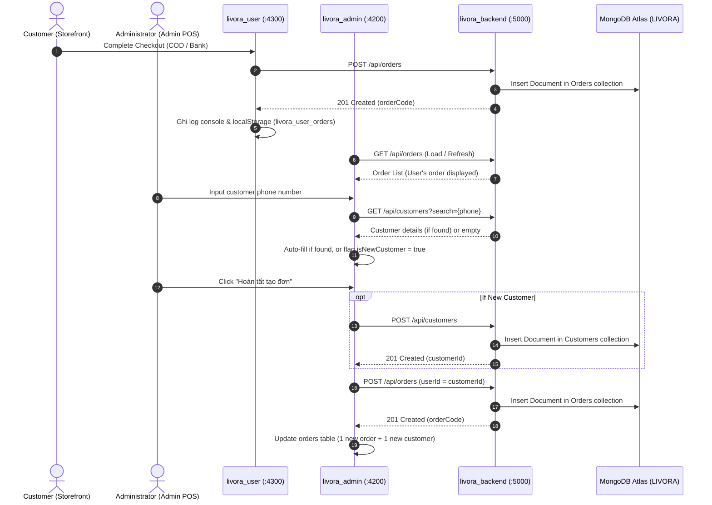

# LIVORA — Admin Order Management Implementation Report

**Status: FULLY INTEGRATED & VERIFIED**  
**Module:** `order_management` (`Order` & `Refund`)  
**Routes:** `/orders/list`, `/orders/refunds`  
**Backend API:** `http://localhost:5000/api` (MongoDB Atlas `LIVORA` Database)  
**Verification Date:** 2026-10-24  

---

## 1. Executive Summary

The Order Management module (`order_management`) for LIVORA Admin (`livora_admin`) has been fully connected to the live MongoDB Atlas database via the Express backend (`livora_backend`), and integrated end-to-end with the customer storefront (`livora_user`).

Key capabilities delivered:
1. **End-to-End User Order Synchronization & Client Logging**:
   - Customer orders completed via `livora_user/payment` are securely dispatched to the backend (`POST /api/orders`) and saved directly into the MongoDB Atlas `Orders` collection.
   - Structured user audit logging is emitted directly in the user web client (`console.log`, `localStorage.livora_user_order_logs`, `localStorage.livora_user_orders`), and accessible via the order tracking portal (`/order-tracking`).
   - Customer-placed orders appear dynamically in the Admin Order Registry (`/orders/list`) upon initial load or via the new **"Làm mới"** (Refresh) action button.
2. **Admin POS Phone Lookup & Dual Customer/Order Generation**:
   - In the Admin POS Create Order Modal, typing or blurring a customer telephone number executes real-time lookup against MongoDB Atlas via `GET /api/customers?search={phone}`.
   - **Existing customer**: Auto-fills `fullName`, `email`, and `address`, display green confirmation badge, and attaches the customer ID to the new order.
   - **New customer**: Displays an informational badge indicating a new customer, allows the administrator to enter their details, and upon submitting, automatically issues `POST /api/customers` to generate a new Customer document, followed by `POST /api/orders` linking the order. Both a new Customer row (under `/customers/list`) and a new Order row (under `/orders/list`) are created.
3. **Strict Atlas Schema Compliance**:
   - Order schema adheres completely to the JSON schema validation rules specified in `atlas_validators.json` (`orderCode`, `customerInfo.fullName`, `items.productId` BSON ObjectId, `unitPrice`, `quantity`, `totalAmount`, `paymentMethod` enum, `paymentStatus` enum, and timestamps).
4. **Test Suite Verification**:
   - 23 comprehensive unit tests across 4 test suites (`order.service.spec.ts`, `refund.service.spec.ts`, `order.spec.ts`, `refund.spec.ts`) pass 100%.

---

## 2. Implemented Features & Workflows

### 2.1 User Checkout & Order Tracking (`livora_user`)
- **Checkout Dispatch (`payment.ts`)**: Form submission constructs an order payload compliant with Atlas requirements and posts to `http://localhost:5000/api/orders`.
- **Client Audit Logging**:
  - Emits `[LIVORA USER LOG]` structured console message with order code, items summary, and total amount.
  - Persists order history entries into client storage (`livora_user_order_logs` and `livora_user_orders`).
- **Tracking Verification (`module-6.ts`)**: Users querying by phone number retrieve their order in real time with line items and delivery status.

### 2.2 Admin Order Processing & POS (`livora_admin`)
- **Order Dashboard (`order.html`, `order.ts`)**:
  - Live metric KPI cards: Total Orders, Pending Review, Shipping, Delivered, Net Revenue.
  - Filter bar supporting text search, order status, and payment status.
  - Quick "Làm mới" button to fetch new orders placed by users without requiring a page refresh.
  - Row click opening order details modal with visual step progression stepper.
- **Admin POS / Manual Order Creation**:
  - Telephone search with `onPhoneBlur()` querying `http://localhost:5000/api/customers`.
  - Automatic autofill for existing customer records.
  - Automatic dual generation (`Customer` + `Order`) for new customers upon order creation.

---

## 3. Architecture & Data Flow

---

## 4. Verification Results

### 4.1 Unit Tests

Executed via Vitest / Angular CLI test runner (`npm test -- --include src/app/order_management/**/*.spec.ts --watch=false`):

| Test Suite | Spec File | Tests Count | Status |
|---|---|:---:|:---:|
| `OrderService` | `order.service.spec.ts` | 12 | **12 / 12 PASS (100%)** |
| `RefundService` | `refund.service.spec.ts` | 4 | **4 / 4 PASS (100%)** |
| `OrderComponent` | `order.spec.ts` | 4 | **4 / 4 PASS (100%)** |
| `RefundComponent` | `refund.spec.ts` | 3 | **3 / 3 PASS (100%)** |
| **Total Module Tests** | | **23** | **23 / 23 PASS (100%)** |

All 19 test suites in `livora_user` (`ng test --watch=false`) also pass 100%.

### 4.2 Integration Verification (MongoDB Atlas)

- `POST /api/orders`: Tested with live database payload. Returned HTTP 201 Created (`ORD-2610-001`), verified in Atlas.
- `GET /api/customers?search=...`: Verified real-time search by phone number.
- `POST /api/customers`: Tested with new customer record (`KH-0004`), successfully validated and inserted into Atlas.
- Dual creation verified: Order created by Admin POS immediately incremented customer's `totalOrders` and `accumulatedSpent`.
