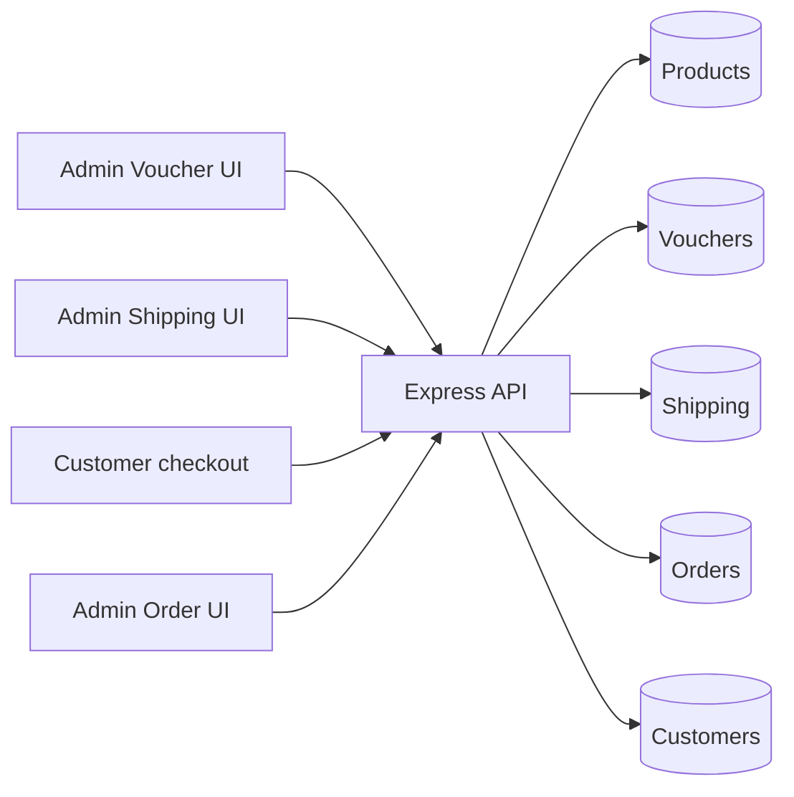

# Voucher, Shipping and Checkout Integration Design

**Status:** Implemented and verified against an isolated local MongoDB replica set. Shared-database acceptance is open.

## Data flow and monetary contract

Admin Voucher and Shipping pages use their existing MongoDB-backed REST services. Their APIs require an Admin JWT. Customer checkout fetches available shipping options and a server quote from the same collections. The server re-reads Product, Voucher and Shipping records inside the order transaction. All money is integer VND. An eligible voucher discounts product subtotal only; `final = max(0, subtotal - discount) + shippingFee`. Percentage discounts use the existing `Math.round` behavior and honor `maxDiscountAmount`.

| Endpoint | Access | Purpose |
|---|---|---|
| `GET /api/checkout/regions` | Public | Active configured provinces. |
| `POST /api/checkout/shipping-options` | Public | Available methods and fees for persisted product IDs, quantities and province. |
| `POST /api/checkout/quote` | Public, or Customer JWT when a voucher is used | Server-calculated product subtotal, voucher discount, selected shipping fee and final total. |
| `POST /api/checkout/orders` | Guest or Customer JWT | Validate identity, addresses, product IDs, voucher and shipping again; create a priced order. |
| `/api/vouchers`, `/api/shipping`, `/api/orders` | Admin JWT | Existing management and order APIs. The legacy Admin POS order endpoint is protected but remains separate from Customer checkout. |

The checkout order request accepts product IDs and quantities, a shipping configuration ID, province, optional voucher code, contact/address details, a supported payment method and a caller-generated request key. Client-provided totals, discounts, shipping fees and customer IDs are rejected. The request key maps to a stable unique order code, preventing duplicate orders and voucher consumption on retry. A reused key with different content returns a conflict.

## Voucher rules

The server checks active state, start/end dates, minimum eligible subtotal, global quantity, and per-customer usage. Existing Voucher schema has no product/category eligibility field, so no extra eligibility rule was invented. Voucher use requires a logged-in Customer because the per-customer limit needs a stable identity. The order stores voucher ID, code and discount snapshot. Order creation atomically reserves voucher usage, decrements inventory, creates the order and updates customer counters. On first cancellation of a new checkout order, a transaction restores usage, stock and customer counters. A second cancellation is rejected.

## Shipping rules

The server matches an active configuration to the exact province or the existing nationwide label, applies the stored fee/free-shipping threshold, and rejects unavailable methods. The selected configuration ID, method, province and fee are saved on the order. Later shipping configuration edits affect new quotes but never rewrite historical order totals. The Customer Website clears its quote when the cart, address, shipping method or voucher changes. The Admin Order detail displays the persisted shipping method and province.

## Payment and shared-contract limits

COD and bank transfer create a pending order; the backend does not claim a bank payment was settled. The previous placeholder QR did not contain a real payment account, so checkout now shows an order receipt with pending transfer guidance. A verified account/provider and payment reconciliation workflow need team approval. The existing Admin POS endpoint still has its own historical order pricing logic; unifying it with the customer quote engine and defining role-specific permissions are follow-up shared-contract decisions. Existing mock product cards with non-Mongo IDs cannot be checked out until the team maps them to real Product records; the server correctly rejects those IDs.

## Compatibility

New `Orders` fields (`voucherId`, `shippingConfigId`, `shippingMethod`, `shippingProvince`, `checkoutRequestHash`) are additive and nullable for historical orders. The existing `orderCode` uniqueness is reused for idempotency; no Atlas migration or index rewrite was performed. No Room, Inspiration, Space or RoomDesign code was changed.
