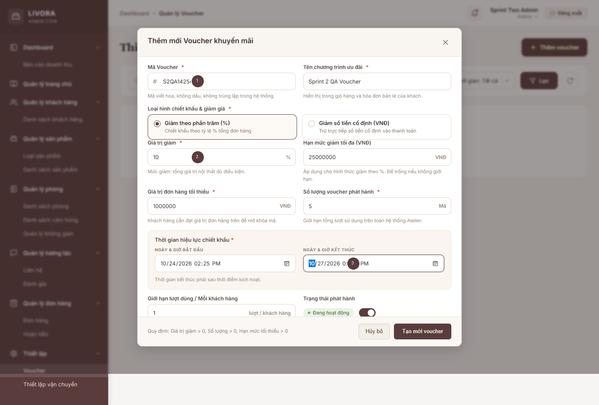
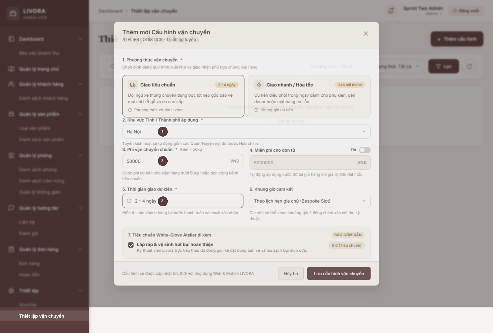
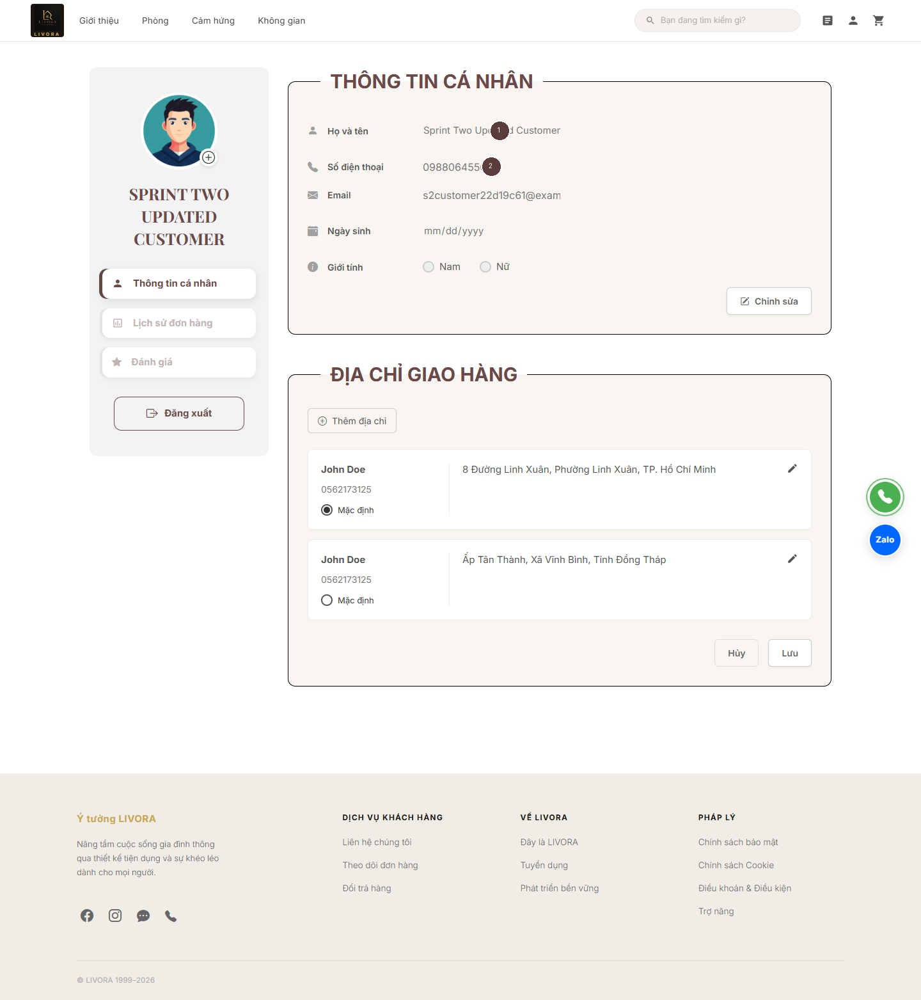
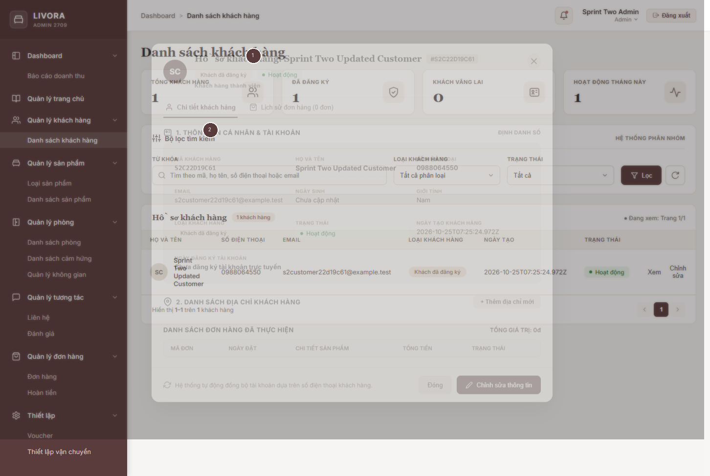
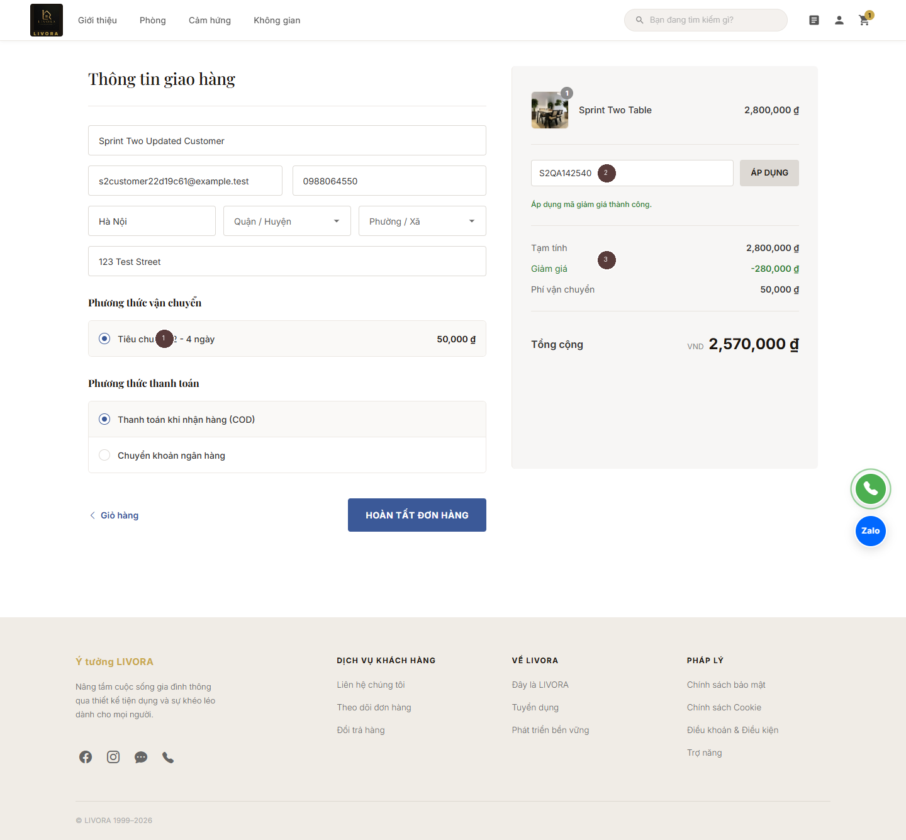
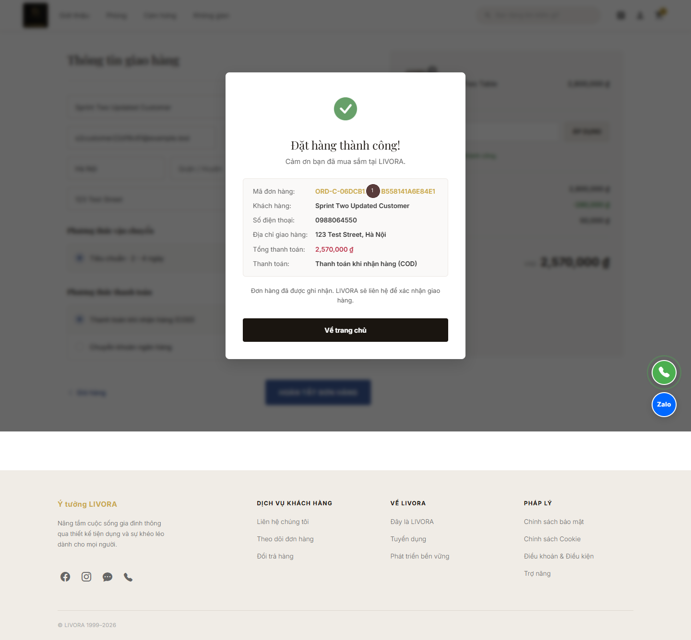
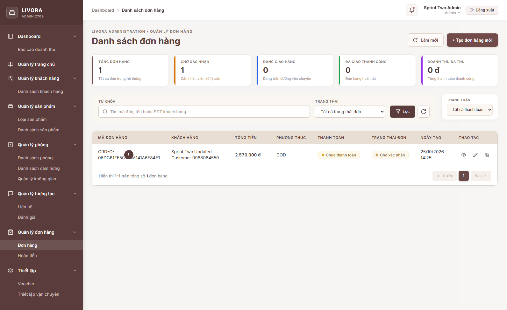

# LIVORA Sprint 2 Implementation Report

**Status: SCOPE CLEANUP VERIFIED LOCALLY — CONDITIONAL GO**

**Developer:** Tống Phước Hưng
**Date:** 2026-10-25
**Branch:** `feature/customer-settings-integration` at integration baseline `origin/main` `8ae55fd`
**Git at verification:** No commit, push or merge had been performed. The original `hung-room-management` checkout and its two pre-existing uncommitted backend dependency edits were preserved.

## 1. Executive summary and scope

Customer profile changes now persist in the MongoDB `Customers` collection and are visible in Admin Customer Management after refresh/detail revalidation. Admin-created Voucher and Shipping records are consumed by Customer checkout. The backend calculates integer VND totals, revalidates references when placing an order, stores Voucher/Shipping snapshots, and protects retries and transactional resource updates. Browser and database verification passed against an isolated local MongoDB replica set. Acceptance against a team-managed shared database remains open.

## 2. Repository and architecture audit

The latest fetched integration branch was `origin/main` at `8ae55fd`. The repository now includes Express/Mongoose in `livora_backend`; older frontend-only statements in `SYSTEM_DESIGN.md` were historical and have been annotated. Existing Admin Customer/Voucher/Shipping services already used backend APIs, while Customer profile Save, login, voucher/shipping checkout and some account history remained disconnected or simulated. The old public order endpoint trusted a client-provided shipping fee and product fallbacks. The Sprint 2 worktree was isolated from the original dirty checkout. Room, Inspiration, Space and RoomDesign source was untouched.

The original checkout's Atlas configuration was used for a **read-only** audit: 10 Products, 2 Vouchers, 5 Shipping configurations and 2 Orders. Inspected monetary values were integer VND-sized amounts; no USD conversion, migration or Atlas write was performed. All development writes and screenshots used local MongoDB on `127.0.0.1:27019` in a disposable replica set database.

## 3. Implemented data flow and API contract

| Flow | Backend contract | Persistence and validation |
|---|---|---|
| Customer identity/profile | `POST /api/auth/customer/login`; `GET/PATCH /api/auth/customer/me` | JWT resolves an active Customer by ID. Profile update allowlists name, phone, birth date and gender; responses omit password hashes. The pre-existing registration API remains; Sprint 2's independent signup UI and order-history endpoint were separated. |
| Admin Customer | Existing `/api/customers` list/detail routes | Requires Admin JWT and persisted Employee. Detail modal fetches the current Customer record. |
| Voucher | Existing Admin `/api/vouchers`; `POST /api/checkout/quote` | Active/date/minimum/quantity/per-customer rules from MongoDB; discount applies only to product subtotal. |
| Shipping | Existing Admin `/api/shipping`; `GET /api/checkout/regions`; `POST /api/checkout/shipping-options` | Active province or nationwide configuration and persisted fee/free-shipping threshold. |
| Order | `POST /api/checkout/orders`; Admin `/api/orders` | Server-authoritative pricing, request-key idempotency, transactionally updated stock/voucher/customer counters, and saved price/shipping snapshots. |

**Money rule:** integer VND; `subtotal = sum(persisted unit price × quantity)`, `discount = eligible voucher discount capped at subtotal`, `final = max(0, subtotal − discount) + shipping fee`. The verified browser order was 2,800,000 − 280,000 + 50,000 = **2,570,000 VND**. The same values were read back from MongoDB.

New nullable `Orders` fields are `voucherId`, `shippingConfigId`, `shippingMethod`, `shippingProvince` and `checkoutRequestHash`; existing order documents are not rewritten. `Order.customerId` retains the canonical Customer reference. Cancelling a new checkout order once restores inventory, voucher usage and customer counters in a transaction; a repeat cancellation is rejected. COD and bank transfer start as pending. A previous placeholder QR had no verified payment account and was removed from the Customer flow; no email-confirmation or payment-settlement claim is made.

## 4. Security and compatibility

With user approval, demo/master-password login paths and automatic default-account creation were removed. Admin Customer, Voucher, Shipping and Order APIs require a signed JWT tied to a persisted Employee. Customer profile endpoints require a signed JWT tied to an active Customer; an arbitrary customer ID or administrative field cannot be patched. The legacy Admin POS `POST /api/orders` remains authenticated for compatibility, but still has its own historical pricing logic and should be unified with the checkout engine by a later team decision. Unsafe maintenance endpoints are disabled by default and require an explicit environment switch plus Admin JWT.

Shared compatibility decisions remain: a role matrix for fine-grained employee permissions; a secure password recovery channel for existing accounts lacking usable password hashes; a verified bank transfer account/provider and payment reconciliation; mapping customer mock product cards with non-Mongo IDs to real Products. These are not represented as completed integrations. The disclosed Atlas database password and JWT secret should be rotated by the credential owner; neither is copied into this worktree or report.

## 5. Test and database results

| Check | Result | Evidence/limit |
|---|---|---|
| Backend profile and checkout tests | **6/6 passed** | Local replica set; includes pricing, idempotency, tampered fee rejection and cancellation rollback. |
| Customer full test suite | **19/19 passed** | Initial parallel run exhausted a Vitest worker; sequential rerun passed. |
| Admin baseline suite | **79 passed, 125 failed** across 204 tests | Clean `origin/main` worktree with equivalent dependencies. Exact named-test comparison against the pre-cleanup branch found **zero newly introduced failures**. Many tests expect obsolete mock counts and lack HTTP fixtures. |
| Admin cleanup checks | **14/14 Order service tests passed; full suite 81 passed / 125 failed / 206 total** | Two focused tests added for local-only Order retention/deduplication and honest offline persistence messaging. All 204 baseline test identities retain their prior status; no new failures. |
| Admin development build | **Passed** | Current Sprint 2 source. |
| Customer development and production builds | **Passed** | Customer production build retains an initial bundle warning. |
| Admin production build | **Failed** | Existing 8 kB per-component CSS errors: Login 9.08 kB, shared DataTable 9.15 kB, Homepage 27.61 kB. The affected CSS files and `angular.json` are byte-identical to `origin/main`; no global budget was raised. Minimal proposed fix: move only genuinely shared rules into an existing global stylesheet or split feature CSS while preserving selector scope, with owner review for Homepage/shared DataTable. |
| Edge browser E2E | **8/8 steps passed** | Admin creates Voucher/Shipping; Customer login/profile save/reload; Admin sees update; combined checkout; Admin sees order. Genuine annotated screenshots below. |
| Local MongoDB/API verification | **19/19 checks passed** | Same customer ID, VND snapshots, stock/usage counters, Admin read, unauthorized access, invalid references, tampered fee, inactive shipping and historical fee immutability. |

The local fixture uses one disposable Admin account, one Customer and one real Mongo Product. Its passwords are generated at runtime into ignored `.venv/qa-credentials.json`; the `.venv/` ignore entry remains as a credential-protection measure. Credentials are absent from report artifacts. The original results are in `reports/sprint-2/evidence/browser-results.json` and `database-and-security-results.json`.

## 6. Genuine browser evidence

Each annotated image below is derived from a real Edge/Playwright capture. Numbered markers identify the UI elements named in the adjacent `*-annotations.txt` file. The underlying raw PNG is preserved next to each annotated copy.

## 7. Changed areas and documentation

Backend changes cover authentication, checkout, profile, order pricing/snapshots, guarded routes, transaction support and focused tests. Customer changes cover real login, profile, cart and checkout. The independent Customer signup UI and new Order History API/UI were separated; the existing history markup was restored. Admin changes cover login, Customer detail, Order display/sync and attaching Admin authentication to relevant calls. The Sprint 2 design documents are `CUSTOMER_PROFILE_INTEGRATION_DESIGN.md` and `SETTINGS_CHECKOUT_INTEGRATION_DESIGN.md`; the earlier `CUSTOMER_MANAGEMENT_DESIGN.md` was preserved with a short historical note. Verified shared architecture is appended to `SYSTEM_DESIGN.md`. Room artifacts and the original screenshot evidence were preserved.

## 8. Remaining limits and team decisions

1. A team-managed writable dev/test MongoDB and safe credentials have not been confirmed. Shared-database acceptance is blocked; Atlas was only read.
2. Existing Admin mock-era unit tests and the production CSS budget remain failing. The CSS and budgets are unchanged from `origin/main`; coordinated cleanup is recommended without hiding failures.
3. The Admin POS order contract, fine-grained role policy and bank-transfer settlement need team decisions. Existing mock catalog items with non-Mongo IDs are rejected by the new checkout API until linked to persisted Product IDs.
4. Password recovery and email change need a verified delivery/security flow. No confirmation email is sent. Existing demo accounts without real password hashes cannot use the removed fallback login.
5. Browser and transactional tests were run only against the isolated local database; they do not prove behavior under shared Atlas data, production traffic or a deployed payment provider.

## 9. Acceptance checklist

- [x] Safe branch from latest fetched `origin/main`; original uncommitted work preserved.
- [x] Customer profile saved/reloaded and read by Admin under the same persistent ID.
- [x] Admin Voucher and Shipping created in browser and consumed by Customer checkout.
- [x] Backend VND quote matches persisted order; voucher/shipping snapshots and idempotency tested.
- [x] Unauthorized and manipulated requests rejected; cancellation resource rollback tested.
- [x] Genuine annotated screenshots and local database evidence retained.
- [x] English design and implementation documentation plus DOCX report generated.
- [ ] Shared team database acceptance and credential rotation completed by environment owner.
- [ ] Admin stale unit tests and production CSS budget resolved with module owners.
- [ ] POS pricing, employee roles, secure recovery and bank settlement contracts approved.
- [x] No commit or push was performed during implementation and QA.

## 10. Scope cleanup and repeat verification

The pre-commit audit identified several mixed-scope hunks. Cleanup **retained** the Customer profile save/load and Admin refresh, server-authoritative Voucher/Shipping checkout, additive Order snapshots, secure JWT guards, no demo/master-password bypass, disabled fake OTP recovery, transactional stock/Voucher/Customer updates, and checkout-specific cancellation rollback. The Admin Shipping and Voucher write controllers now reject fractional or unsafe VND fields; checkout also rejects malformed persisted fee, threshold, fixed discount, minimum/cap, line subtotal and total amounts rather than reinterpreting them. Percentage discounts retain fractional percentages but round the resulting VND discount to an integer. Focused tests cover decimal Admin inputs, malformed persisted settings, rollback, idempotency and a bank-transfer Order remaining `pending`.

Cleanup **separated** Customer Order History: the original history markup and actions were restored, and the added history fetch, DTO and `/api/auth/customer/orders` route were removed. It **separated** the newly active Customer signup UI and frontend registration method; the existing backend registration endpoint remains, with its strengthened input validation as a security safeguard. Real Customer login and the profile API were retained. No Room, Inspiration, Space or Product Management file was changed.

The previous QR popup and its client-controlled confirmation cannot safely be restored because they did not prove receipt or settlement. The current bank option creates an Order with `paymentStatus=pending` and states that transfer details require an official channel; the payment owner must decide the final bank-transfer instructions and reconciliation. COD continues through server checkout. The Admin Order service now merges only locally generated, unsynced POS Orders with backend Orders by order code; built-in demo Orders are excluded after a backend response. A backend-confirmed Order wins on code collision, so refresh does not duplicate it. If a POS backend write fails, the UI message says the Order exists only in browser storage and warns against a blind retry; it no longer claims MongoDB persistence. Legacy POS pricing and bank-payment marking remain separate owner-owned behavior.

**Repeat verification on a disposable local MongoDB replica set:** Backend focused tests **6/6**, Customer suite **19/19**, Admin Order service **14/14**. With the backend stopped to match baseline test conditions, the Admin full suite had **81 passed / 125 failed / 206 total**: the 204 original tests retained exactly the baseline outcomes (79 passed / 125 failed), and both newly added tests passed. Admin Customer/Voucher/Shipping focused specs still have **44 pre-existing failures and 8 passes** from stale mock/HTTP expectations; the same 44 named failures were present at the clean integration baseline. A repeat Edge browser run passed **8/8** steps: Admin real login, Admin Voucher create, Admin Shipping create, Customer real login, profile save/reload, Admin read of the same Customer, combined Voucher/Shipping checkout, and Admin read of the persisted Order. Direct MongoDB verification confirmed the same Customer ID, Voucher code, Shipping configuration, one Order and integer **2,570,000 VND** total. A separate bank browser exercise and DB read confirmed one bank-transfer Order with `paymentStatus=pending`; no payment settlement was claimed. The repeat browser outputs were written to an isolated temporary directory; the seven original annotated screenshots and their raw files were not overwritten.

The first repeat browser attempt timed out waiting for full page load, and the next reached Admin Shipping creation before the Windows console rejected a Vietnamese character. The final run used DOM-ready navigation and UTF-8 output and passed all eight steps. An initial readback assertion incorrectly expected `QA` in the fixture name; inspection showed the configured name was `Sprint Two Updated Customer`, and a corrected exact-name/ID/order check passed. These harness corrections did not change application code or the stored amounts.

**Remaining approvals:** payment owner for bank-transfer instructions/settlement and legacy POS payment marking; Order/inventory owner for cancellation reconciliation when referenced documents are deleted and legacy POS pricing; backend/security owner for Employee role policy, secure recovery, startup and seed behavior; data owner for any historical non-integer or USD records and the mock catalog-to-Mongo Product mapping. Shared Atlas acceptance remains open; no shared database migration or write was performed. The final pre-commit assessment is **CONDITIONAL GO** after these owner decisions and environment acceptance. No commit, push or merge was performed. At final inspection, 86 paths were staged by an action outside this cleanup session while nine paths had newer unstaged edits and this summary was untracked; the current index must be reconciled before any commit, because it is not the final verified working tree.
